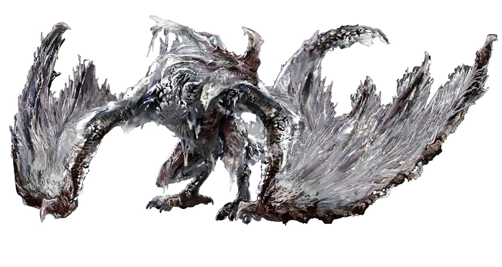

# 凍結冰霧・玻列琉斯：原作考據與實作

更新：2026-11-09。先完成考據與 33 張參考圖片後，使用者以「開始製作」授權依方案實作。**角色已加入遊戲；實作回執見下方。**後面的提案段落保留研究階段的討論與原作／改編界線；實際數值、完成狀態以本節為準。

[33 張本機圖鑑](../research/borealis/gallery.html) · [逐圖來源](../research/borealis/IMAGE-INDEX.md) · [研究範圍與缺口](../research/borealis/RESEARCH-LOG.md)

## 本次實作回執

- 選角第 5 頁可選「凍結冰霧・玻列琉斯」，可 AI 觀戰或親自操控。已接訓練場、輕快／沉重、團隊、獵魂與 4v1 裝備資料；不改存檔格式。
- 自繪外觀：暗灰龍體、暗紅破翼、霜白碎片、額前長角、翼腕與兩條後腿、長尾。動作有前噬、翼掃、抬腳踏地、回身甩尾、昂首、抬升、翼拍、收翼和落地；滯空時地上保留龍影。參考圖全部仍是研究材料，沒有匯入遊戲作貼圖。
- 11 招為冰牙前噬、霜翼橫擊、踏冰揚霧、迴身霜尾、冰霧直息、橫掃冰息、後撤俯息、懸空覆霜、冰翼撲落、凍結咆哮，以及半血解鎖的龍饗冰霧。普通咬擊、翼擊、尾鞭不直接附凍傷；踩踏殘霧可累積。
- 被動「冰結湖遺霧」：落地行動每 8 秒，先亮出固定位置的 0.65 秒預警，然後留下 3 秒冰霧；每隻至多一個自己的被動霧圈。升空或轉階段會重置這輪計時與待發霧；死亡不再散出新霧，既有霧按壽命消失。
- 凍傷上限 100、自然每秒減 5，10 秒沒再累積就清除剩餘值；滿值後只爆發一次，再有 8 秒承傷 ×1.12、耐力恢復 ×0.85，不會冰封或禁足。爆發基礎量是 `60 + min(300, 最大生命 × 0.06)`，仍經一般傷害結算，包括浮動、增減傷和護盾。發作時不再累積或刷新；真正造成正數傷害的火焰可解除，接著有 2 秒回溫間隔。改火色不算火傷，未命中／無敵／全吸收也不解除。
- 半血「白霧再臨」：2.7 秒轉場、背脊霜線與霧環、解鎖龍饗幻影；速度 ×1.08、傷害 ×1.1、冷卻 ×0.9。大招第一階為長吼、橫息、冰環；第二階追加低空掠息、升空撲落、三重外擴冰環。時間會隨遊戲節奏拉長，不把研究草案的約 6 秒當作兩種節奏的固定時長。
- 17 種專屬特效：口前蓄息、多層吐霧、冰屑、腳下霜線、翼尾雪弧、龍吼霧浪、起飛翼風、落地裂冰、外擴冰環、龍饗、凍傷爆發、回溫與半血。用現有冰霜／風／重擊音效接線；沒有下載原作音軌。
- 基礎 HP 5350、移速 215、碰撞半徑 96、招式尺寸 ×1.6、Boss 3 星；沉重只對本角色用耐久 ×1.2、技能傷害 ×1.15。均是本遊戲調整。每節奏對 27 種對手 × 3 種子 × 交換藍紅的 162 場：輕快 90 勝（55.6%，平均 56.49 秒）、沉重 83 勝（51.2%，平均 93.48 秒）。這是指定樣本，沒有當成全地圖／團隊的保證勝率。
- 修正實測問題：沉重初版過強，因此只調新角色的倍率；長吐息遇安全圈會在反應時間後付出已耗資源收招，再走位，升空招式仍保留落地。既有角色不開啟這個選用行為。沒有降低測試門檻。

### 檢查與試玩

`npm test` exit 0：28 位 Boss、訓練場 6,113 項、全配對 2,352 場全部完成；輕快歷史指紋 3,174/3,174 逐幀一致。`node test/fingerprint.js --check-heavy` exit 0，沉重歷史指紋同樣 3,174/3,174 一致。相對歷史基準新增的 1,530 場配對每種節奏都另行模擬，沒有歷史基準，不稱作結果相同。兩份正式基準未重建。完整回執：`test/borealis-final-full.log`、`test/borealis-final-heavy.log`。專屬機制、全招兩節奏兩階段命中及落地、31 場鏡像／團隊／4v1／重現性／特效開關一致已通過；另驗證撤招不退還體力冷卻、不提前讀預警、不取消飛行落地。強度明細在 `test/borealis-strength-results.json`，指令 `node test/borealis_strength.js`。

真實本機 Chrome 最終版已通過：13 張畫面、17 種特效 × 20 種元素、JavaScript 頁面例外 0；對亞基爾完整 AI 對戰約 105.9 秒正常結算，由亞基爾獲勝。`screenshots/borealis/verification.json` 記錄實際值。技能展示是在訓練場按實際時間軸定點截圖，完整 AI 對戰則另跑，不混稱為 AI 自主選招。390px 畫面可顯示，但訓練介面會整體縮小；沒有當作手機操作手感已驗收。最後補厚白霧、收細亮束後另跑專屬機制／特效開關一致與 Chrome 檢查，均通過。研究圖鑑原有的 33 張載入與來源檢查仍獨立保留於研究資料夾。

試玩：雙擊專案 `index.html`，在選角第 5 頁選玻列琉斯。先選上方「訓練場」再按「進入訓練場」，可逐招按鈕展示；切第二階段可試龍饗與完整大招，回選單可安排與亞基爾、艾格基斯互戰。

未驗證：使用者實際試玩接受、人工音效聽感、長時間效能；自動與瀏覽器檢查不能代替這些。`driver-accepted = false`。沒有改歷史指紋基準、Git 提交／推送或發布。工作區既有墜星成獸等改動保留。

以下是製作前的考據與提案紀錄。

## 先看建議做成什麼樣

建議做成一頭**身披霜白碎片、以巨翼撐地的冰霧飛龍**：近身用重踏、回咬和尾鞭逼退對手，遠處用貼地吐息追著戰場推進；最醒目的招式是昂首咆哮後，白霧像潮水一圈圈翻出去。

華麗感放在龍體動作、霧浪層次、腳下結霜、碎冰折光和空中掠過的巨影。保留黑灰鱗甲、暗紅翼膜與白霜的層次，避免整頭畫成沒有肉身的透明冰雕。半血強化和全場大招可以很盛大，但它們是這款觀戰遊戲新增的演出。

這頭龍與亞基爾、艾格基斯的主要差別：**冰霧累積凍傷 → 凍傷爆發 → 讓後續重擊更危險**。霧會慢慢散，龍體與交戰方向持續看得見，觀眾才能知道誰正在壓制誰。

## 這次查了哪些材料

- 文字：9 組已打開原頁核對的正式整理來源，包括發行商的凍傷說明、FromSoftware 的畫冊公告、日文與英文 Boss 攻略、龍饗祈禱頁與概念圖收錄頁。
- 圖片：47 張成功取得的候選，加 1 張正常瀏覽器頁面中的概念圖元素截圖，共 48 張逐一查看；最後採用 **33 張**，排除 **15 張**。
- 採用的 33 張包含 29 張靜圖和 4 段 GIF。靜圖包含 1 張概念圖、1 張祈禱圖示、1 張遊戲攝影；其餘為遊戲畫面、攻略封面與攻略縮圖。GIF 每段只計一張，抽幀圖、縮圖和同畫面的裁切都不另加張數。
- 實際查看包括全部候選聯絡表、4 段 GIF 各 5 個時間位置，以及第 024、040、048 張的完整尺寸。其餘以完整構圖縮放查看，不冒稱全部都做過像素級細節核對；GIF 也不是逐幀完整分析。
- 作品範圍是 **2022 年《艾爾登法環》本篇的玻列琉斯**。沒有把《黑夜君臨》的卡利戈招式、設定或圖片混進原作證據。

## 能確認的原作內容

| 問題 | 本輪結論 | 證據與可信程度 |
|---|---|---|
| 是誰、在哪裡？ | Borealis the Freezing Fog；日文「凍てつく霧、ボレアリス」。巨人山頂冰結湖的可選野外 Boss，接近時會遇上風雪。 | [Game8 Boss 頁](https://game8.jp/eldenring/444834)、[Gamepressure](https://www.gamepressure.com/elden-ring/borealis-the-frozen-fog/zffcdb)與原作畫面相互核對。繁中名稱沿用使用者指定的「玻列琉斯」。 |
| 過去有什麼故事？ | 冰龍一族曾佔據山巔，後被火焰巨人擊敗、逐離頂峰。不能據此認定玻列琉斯本人就是某位有名有姓的龍王。 | [Gamer Guides 的 Lore 段](https://www.gamerguides.com/elden-ring/database/bosses/mountaintops-of-the-giants-boss/borealis-the-freezing-fog)有可讀轉述；與祈禱轉錄線索一致。此次未親自拍到遊戲內完整物品說明，保留二手轉錄身份。 |
| 怎樣的身體？ | 兩個帶爪的翼肢兼作前方支點，另有兩隻後腿、長頸與長尾；額前長角、粗糙暗鱗、霜白碎片狀覆蓋與暗紅內膜。 | 實際查看 `bo-ref-014/024/036/039/048`。這是可見外觀，不把覆蓋物的材質或器官功能當成已知設定。 |
| 用什麼攻擊？ | 咬、甩尾、踩踏、地面冰息、空中冰息、升空後撲落，以及大範圍咆哮冰霧。踩踏也會留下累積冷氣的霧。 | [GameWith](https://gamewith.jp/eldenring/325390)、[EIP](https://eip.gg/elden-ring/guides/how-to-beat-borealis-the-freezing-fog/)配合 `bo-ref-011/013/028/029/030`。沒有完整逐幀判定表。 |
| 凍傷是什麼？ | 冷氣先累積，發作時造成生命損失，接著暫時提高承受的傷害、降低耐力恢復；火焰可解除。不是長時間把對手鎖在冰塊裡。 | [Bandai Namco 官方玩法說明](https://www.bandainamcoent.com/news/elden-ring-introduction-part-1-stats)。本提案不把玩家狀態數值直接照搬成全體 Boss 的數值。 |
| 擊敗後得到什麼？ | 龍心、100,000 盧恩，並解鎖可在大龍饗教堂用兩顆龍心換取的「玻列琉斯的冰霧」。祈禱不是直接掉在背包內。 | [Game8 祈禱頁](https://game8.jp/eldenring/443586)與 Boss 攻略交叉核對。獎勵不是本遊戲角色能力值。 |
| 原作有沒有二階段？ | 攻略對「階段」的用法不同：Gamepressure 寫單一階段，SAMURAI GAMERS 提到低血量會用強力咆哮。可合理區分「招式選擇改變」與「有一段正式變身」。**本輪沒有證實固定 50% 血量變身。** | [Gamepressure](https://www.gamepressure.com/elden-ring/borealis-the-frozen-fog/zffcdb)、[SAMURAI GAMERS](https://jp.samurai-gamers.com/eldenring/er-boss116/)。精確咆哮閾值和連吼次數仍未核實。 |

性別、確切年齡、個人家族關係、是否親歷古代戰爭，以及對火焰巨人的個人仇恨：**本輪沒有找到足以確證的資料**。可以用失落冰龍一族的意象做演出，不替牠補寫官方生平。

## 概念圖找到什麼

上圖來自 [Creative Uncut 的角色專頁](https://www.creativeuncut.com/gallery-43/er-borealis-the-freezing-fog.html)。直接圖片請求曾被拒絕，正常 Chrome 頁面卻能正常載入；本輪保存的是該頁**正常顯示的圖像元素截圖**，並保留頁面上下文與載入回執。沒有偽造請求標頭、操作驗證或下載整本畫冊。

它提供很有用的造型依據：翼腕粗重，翼尖如扇形骨架展開，邊緣拖著大量霜白破片；額前長角與頸側垂片形成頭部辨識；黑灰鱗片、暗紅膜面並未被白霜完全吃掉。它是一張獨立構圖，**不是已取得三視圖、骨骼結構稿或動畫設定表**。

[FromSoftware 的官方公告](https://www.eldenring.jp/newsdetail/news_detail_221129_1.html)確認 Volume II 收錄敵人與武器概念圖、道具美術；但本輪還沒有定位這張圖在紙本／電子版的頁碼，也沒有確認單張畫師。因此交付標記為「概念圖參考，官方出版定位待核」，不把收錄網站的分類直接當成完整的官方出處證明。

## 外觀製作提案（未實作）

| 部位 | 要保留的原作特徵 | 在俯視觀戰畫面中的做法 |
|---|---|---|
| 全身輪廓 | 翼肢兼前肢、兩後腿、低伏胸腹、長頸長尾 | 沿用亞基爾／艾格基斯目前的巨龍尺寸級別。先以巨龍縮放 1.6 作試作起點，最終看訓練場實際畫面決定；不是原作身高換算。 |
| 頭頸 | 額前突出的長角、長吻、頸側霜白垂片、暗紅口腔 | 咬擊先探頸再閉顎；吐息先縮頸鼓喉再放出氣流；咆哮整段昂首，跟地面噴息一眼分開。 |
| 雙翼 | 厚翼腕、暗膜面、破碎霜白翼緣 | 步行時左右翼腕交替支地；起飛時完整展翼；冰霧沿翼緣被扯成長條，再碎成亮點。 |
| 背與鱗甲 | 暗灰底色、層疊粗鱗、順脊尖片 | 深色體塊托住白霜，不能全身白成同一色。半血時沿脊背逐段結亮是新增演出，不增加原作不存在的大水晶角。 |
| 尾與後腿 | 長尾漸細、後腿粗壯、爪指落地 | 甩尾先反方向蓄勢，命中時尾尖帶出弧形雪塵；踩踏抬腿後明顯下壓，留下薄薄霜圈。 |
| 色彩 | 灰黑、霜白、暗紅膜面 | 藍青光集中在冷氣與反光；`bo-ref-040` 的高飽和攝影只參考氣氛，不把後製色當成官方皮膚色。 |
| 飛行與陰影 | 展翼、後腳收放、長尾拖曳 | 地上保留完整龍影，龍體升到畫面上層；吐息向腳下／前方落地，落地有雙翼緩衝和胸腹壓低。 |

聲音提案：低頻龍吼、翼膜拍風、冰粒碎裂、長吐息的冷風聲。先盤點專案已有音效，再決定接線；本輪沒有下載新音效，也沒有聲稱已有對應原作音軌授權。

## 凍傷與被動提案（本遊戲規則）

**凍傷改編規則：**命中冰息或站在有效冰霧內會累積凍傷，離開後逐步消退。滿值時碎冰爆開，造成一次傷害；短時間內承受後續攻擊更痛，耐力回復變慢。發作期間不再重複累積，避免一口氣連爆或永久刷新。

第一版調校起點可以是：累積上限 100、自然每秒下降 5；爆發傷害為「60 加上最大生命 6%，其中比例部分最多 300」；後續 8 秒承受傷害 ×1.12、耐力恢復 ×0.85。**這些全是提案值，沒有做過對戰測試，並非原作數值。**耐力就是角色用來出招和閃避的資源。

火焰命中可解除已發作的凍傷，但火傷本身照算；解除後留 2 秒抗重複爆發間隔，避免火系隊友把凍傷瞬間洗掉、再灌滿造成失控循環。這個 2 秒間隔是本遊戲調整，不冒稱原作規則。

**被動「冰結湖遺霧」：**玻列琉斯落地行動時，約每 8 秒吐散一次貼身霧圈；先有 0.65 秒可見的霜線，再出現約 3 秒的冰霧。靠近會累積凍傷，向外走便能停止累積。升空、倒下或轉階段時停止新一輪散霧；已散出的霧按正常時間消失。第一版最多同時保留一個被動霧圈。

被動的原作意象來自冰結湖風雪、踩踏殘霧和近身咆哮；**「每 8 秒自動散霧」是新增規則**。受擊不立刻反傷，也不直接送對手凍結，讓近戰 Boss 有清楚的追打窗口。

外觀上長駐的細雪、呼吸白氣只是裝飾；真正會累積凍傷的霧區有亮邊、結霜地紋和剩餘時間變淡，避免觀眾把所有白煙都當傷害區。

## 十一個普通技能提案

以下名字是為本遊戲整理的中文招式名；除正式祈禱名外，不聲稱原作 UI 逐招使用這些名稱。尚未決定傷害、冷卻和每段判定。

| 招式 | 依據身份 | 動作、演出與對戰用途 |
|---|---|---|
| **冰牙前噬** | 原作咬擊改編；014/015 與攻略 | 頸部後縮、長吻前探、上下顎閉合；齒間甩出霜屑。快而短，打斷貼頭纏鬥；不是憑空飛出的冰龍頭。 |
| **霜翼橫擊** | 飛龍翼肢動作的遊戲化延伸；未取得此單招完整原作影片證據 | 單邊翼腕抬起、拍出一道很寬的雪弧，另一翼維持支地。側面範圍比前咬大，但收招較慢；白霜破片沿翼緣甩開。 |
| **踏冰揚霧** | 原作踩踏＋殘霧；011、GameWith | 後腿高抬後重踏，地面先裂出幾條白紋，再翻起低矮霧圈。實體踩踏與殘留霧分開顯示。 |
| **迴身霜尾** | 原作尾鞭；016/029 與攻略 | 龍頭回望、腰背轉動、長尾橫掃，尾尖拖出碎雪弧。用來處理繞背對手，保留轉身前的預兆。 |
| **冰霧直息** | 原作地面吐息；008/034/035 | 長頸貼近地面，先噴出細窄白束再膨成翻滾霧流；喉內發亮，氣團確實從嘴前出發。遠端擴散，兩側仍有繞行空間。 |
| **橫掃冰息** | 原作冰息動作的橫向拆分改編；029、攻略 | 頭頸由一側掃到另一側，白霧分層推過地面，地上留下短命霜痕。不是一次瞬發整片扇形；觀眾能追著龍頭看掃到哪裡。 |
| **後撤俯息** | 後躍／空中吐息的節奏改編；GameWith、013 | 後腳離地、雙翼一拍後退，頭仍朝追擊者向下吐霧；飛行高度不高。逼退貼身對手，留下再次接近的間隔。 |
| **懸空覆霜** | 原作 Flying Frost Breath；012/013、EIP | 先升空短暫停住，再向下前方連吐兩股霧；地面有龍影和落霧方向。吐完才降落，與只升空砸下的技能區分。 |
| **冰翼撲落** | 原作升空撲落；GameWith | 嘴前沒有蓄起長吐息，雙翼收攏，龍影在鎖定落點短暫壓縮，接著重落。落地碎冰向外滑，不把碎冰全部算投射傷害。 |
| **凍結咆哮** | 原作特色；030、GameWith／EIP | 胸腹抬起、昂首張口，白霧先在身側捲起，再以兩層不同速度的圓浪擴出去。第二層和更大的範圍屬於本遊戲放大演出；不能直接稱原作必定二連吼。 |
| **龍饗・玻列琉斯的冰霧** | **玩家祈禱轉為 Boss 技能的新增改編**；023/031 | 僅在半血強化後解鎖：本體抬高，身後短暫浮現大一號的冰龍首輪廓，和本體吐息重疊推進。這個額外幻影不是原作 Boss 已證實的能力。 |

原作證據不足的翼擊，以及把一種吐息拆成多種玩法的部分，均已在表中分開標示。若確認後希望更忠實，可把「霜翼橫擊」換成更短的回身咬擊，不影響其他招式的主軸。

## 半血強化提案：「白霧再臨」

本遊戲通常有半血轉階段，因此建議保留這個結構：玻列琉斯伏低蓄氣，霜線沿尾背朝龍角亮起，再昂首展翼，身邊白霧被一次吼開。灰黑本體仍看得見，不更換成另一隻龍。

強化後開放龍饗招式，冰息分層更密，大招多一段升空與外擴冰環；傷害、速度和冷卻是否增加，以及增加多少，留給實作時的強度測試。**50% 血量轉階段、背棘亮起、幻影龍首都屬於改編。**低血量咆哮的攻略觀察提供氣氛依據，不等於原作已有這套變身。

## 大招提案：「失落山巔・永凍白幕」

它是一段約 6 秒、由原作冰霧意象延伸的全新大招。名字中的「失落山巔」指冰龍一族被逐離山巔的歷史意象；不替玻列琉斯新增官方王位。

| 時間（第一版演出草案） | 畫面 | 對戰仍要看得懂的地方 |
|---|---|---|
| 0–1.2 秒 | 深吸氣，霧流倒捲向口前，背上的霜白尖片依序亮起，雙翼緩緩撐開。 | 亮邊圈先出現；對手與地面方向可見，蓄力能被觀眾辨識。 |
| 1.2–2.2 秒 | 昂首長吼，第一圈厚白霧推出，內側漂起細冰粒，外緣是青藍折光。 | 第一圈有清楚前緣，經過後霧變薄；不用全畫面純白遮住角色。 |
| 2.2–4.2 秒 | 龍體展翼升空，地上巨影掃過，龍首沿弧線灑下冰息，形成彎曲霜路。 | 飛行路線與落霧路徑一致；殘霧範圍不跟著目標瞬間跳動。 |
| 4.2–5.0 秒 | 嘴邊冷光收束，收翼急降，在先前亮出的落點撞出冰面裂紋與扇狀碎冰。 | 落點至少留可反應的預警；不能等命中才畫警示。 |
| 5.0–6.4 秒 | 三道低矮冰環由近到遠依次外擴，霧海裂出可見的暗色地面，龍重新以翼腕撐地。 | 環與環之間有空間和節奏；結束必須真正落地、回到可攻擊狀態。 |

一階段先採較短的「長吼 → 地面霧浪 → 尾端霜爆」。上表的完整升空、弧線吐息、撲落與三環連鎖留給半血後版本，名稱可以改為 **「白霧再臨・冰海葬場」**。

冰環、裂冰、幻影龍首和連鎖落地都是本遊戲新增；不是從《黑夜君臨》另一頭冰龍借來後冒充本篇玻列琉斯原招。若要加極光，它只作新增的背景折光，須另行選定；目前沒有採納。

## 華麗演出的具體清單

預計準備 12 組專屬演出：蓄息口霧、直線吐息、橫掃霧流、空中向下吐息、踩踏碎冰、翼擊雪弧、尾尖霜痕、起飛翼風、落地冰震、咆哮圓浪、凍傷爆裂、半血／大招霜線。普通受擊與小碎屑可沿用既有冰霜特效，專屬部分再加。

粒子分近中遠三層：近處少量較大的冰片、中層翻滾霧團、遠層細雪亮點。霧的中心淡一些、邊緣厚一些，讓黑灰龍體能透出來。咆哮可以震鏡、低頻推近，但避免每次吐息都強震或長閃白。

這是演出規格，**本輪沒有生成遊戲畫面，也沒有做幀率或音效驗收**。參考圖鑑中的全部圖仍是研究材料，沒有成為遊戲貼圖。

## 之後製作時要先處理的接線問題

- 現有霜月魔女的 `frostbite` 是「累積後短暫凍結」的遊戲規則，與這次考據到的凍傷不同。玻列琉斯宜用獨立的凍傷狀態，保留魔女原有行為。
- 耐力回復倍率目前不在已閱讀的通用狀態欄位清單內；若採納，需要最小幅度擴充並驗證未帶此狀態的舊角色行為不變。尚未試作，不能聲稱一定無需改引擎。
- 火焰解除要根據實際傷害的屬性識別，不能只看「特效剛好是火色」就解除。確定方案時先核對專案現有的傷害屬性入口，再決定最小做法。
- 霧的主人、隊伍敵我、重複命中間隔、鏡像冰龍、被打斷／死亡／重置清理，需專屬檢查。
- 訓練場、輕快／沉重、團隊、獵魂與 4v1 都要接好；舊角色的兩份正式歷史指紋基準不自行重建。

這些是後續實作的待辦，**沒有在本輪動手修改遊戲程式、存檔或測試基準**。

## 沒有硬填的資料與下一步

1. 原作 Boss 的精確血量、各傷害抗性百分比與狀態免疫表：此次可讀攻略之間有矛盾，沒有把搜尋摘要中的數字採為定論。
2. 咆哮的血量觸發閾值、連吼條件、逐幀傷害與冰霧判定範圍：未取得遊戲檔案或完整逐幀實測。
3. 概念圖紙本頁碼、單張畫師、原始三視圖與動畫設定稿：未核實／未找到；已有完整可見的獨立概念圖參考。
4. Wiki 部分頁面受阻；MmoGah、SuperSoluce、Sportskeeda 的原頁也不可讀，但所列公開圖片地址可取得並已查看，僅用作圖像參考，不採它們的正文或宣稱已看完影片。失敗與查看方式均保留在研究紀錄。
5. 研究階段沒有遊戲實作證據；本次製作的畫面、勝率與檢查回執列在本文開頭。使用者實際試玩與音效聽感仍未確認，`driver-accepted = false`。

**目前下一步：**使用者試玩本文開頭所列的已實作版本，確認外觀、招式節奏與大招觀感；研究來源和原作證據缺口繼續保留，不因實作完成就補成定論。
